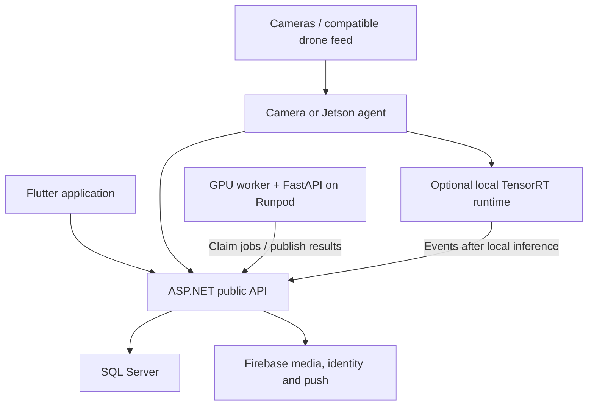

# AgroSentinel — final product architecture

Decision record: 17 October 2026 (Asia/Amman). This replaces the earlier MVP proposal. It describes the final product to implement, not a claim that its services, new models or hardware are already running.

## Confirmed scope and ownership

Exactly five members: Ezzeldeen Alkurd, Sara Hamdan, Khalid Masoud, Raneen Abdullah and Dina Afram. Dina is already working on the fire/smoke datasets/model. There are two distinct plant-model releases: close-up and distant/aerial. Soil analysis is a later extension.

This record uses the user's latest correction, `docs/PLANT_DATA_COLLECTION_PLAN.md`, `docs/PLANT_DATA_PREPARATION.md` (5 October), `data/plant/COLLECTION_STATUS.md`, and current application/backend source. The October data record says preparation is complete and fresh plant training had not started at that point; do not promote old weights as the new models. Dina's latest training progress has not been independently checked because her local contribution directory is empty.

## Selected deployment design

| Component | Selected location | Responsibility |
|---|---|---|
| Public application API | ASP.NET Core 10 on existing SmarterASP.NET Windows hosting, subject to account limits | Owner identity, sites, camera pairing/configuration, jobs, event history, model catalog, signed media access |
| Durable application database | SmarterASP.NET SQL Server, managed through SSMS | Authoritative device ownership, jobs/leases, event metadata, model releases and audit records |
| AI inference | Dedicated Runpod Secure Cloud GPU Pod, Linux container | Python model runtime, FastAPI service, persistent job worker, GPU inference |
| Media | Existing Firebase Storage initially, behind API-mediated access | Input images, evidence and model artifacts in separate controlled prefixes |
| Authentication and push | Existing Firebase Authentication; FCM for background notifications | Retain current sign-in; verify user ID tokens in the API; deliver device notifications |
| Mobile | Existing Flutter application refactored to the public API | Camera/photo upload, pairing, monitoring controls, jobs/results, history and health |
| Camera agent | Windows/Linux computer or Jetson at the camera network | Capture adapters, pairing, cloud/edge selection, sampling, retry and temporal event confirmation |
| Optional edge inference | Jetson runtime profile | Execute compatible approved model exports locally and synchronize events with the same API |

These are selected architecture recommendations. No subscription upgrade, GPU rental, deployment, live database migration or account invitation has been executed by this document.

Use one authoritative data path: **new Flutter repositories call ASP.NET; ASP.NET owns SQL metadata**. Retain Firebase Auth/Storage/FCM for their specific services. Do not keep Firestore and SQL as competing writable copies of the same device/event. Existing Firestore readers are current behavior to replace explicitly. Export and migrate existing metadata, retain original IDs, reconcile counts and attachments, and switch the app only after end-to-end parity checks.

SmarterASP.NET is useful for the application backend. Its current Windows product lists ASP.NET Core 10 and SQL Server; its separate Linux offerings list Python WSGI/ASGI. A Python-capable plan does not establish GPU/CUDA support. Do not place a permanent capture loop, model-training process, or essential in-memory job queue inside a shared IIS application pool. Confirm your exact purchased plan's app-pool memory, idle/recycle behavior, upload/body limits, HTTPS, outbound HTTPS access and database quota before publishing.

Runpod Pods support custom Linux containers and GPU resources. Use a persistent volume for cached approved weights and working files, with authoritative artifacts backed up in object storage. Do not rely on the container filesystem as the only copy. Deploy the built container image directly; Runpod Pods do not support running Docker Compose inside the Pod. A Pod is a deployment instance, not automatic high availability: define restart monitoring, backups and a replaceable worker instance. No claim of guaranteed 24/7 availability is made for one shared host plus one GPU instance.

## Product flows

**Manual image:** Flutter signs in, uploads an image using API-authorized media access, creates an analysis with a specific model ID, and receives a job ID. It watches job status through the API and displays the original label/score/evidence. An expired or unavailable model is reported as unavailable, never replaced silently by an old model.

**Cloud camera:** paired agent captures frames on the local network, samples at a configured rate, uploads selected images and creates analysis jobs. It reads results, applies per-camera event confirmation and duplicate suppression, and submits evidence referencing the original inference result. The service verifies ownership and provenance before accepting an event. Bound outstanding jobs per source and discard stale monitoring frames. Durable user-uploaded photo jobs retry until completion or a visible terminal failure.

**Durable work:** API commits the job to SQL and returns 202. The external GPU worker claims eligible jobs through an authenticated internal API, using a transactional lease. It downloads the controlled image, invokes the selected runtime, and completes with job ID and lease token. Expired leases can be reclaimed; completion is idempotent. Inference completion and notification requests use a durable outbox so app-pool recycling cannot lose processing. The external worker also drains outbox deliveries. Poll/claim endpoints use backoff and bounded batch sizes to respect hosting limits.

**Local Jetson:** agent selects the edge backend, checks the installed model version and hardware capabilities, and runs local inference. It persists confirmed events in a bounded local outbox and synchronizes them after connectivity returns. Cloud metadata remains authoritative for ownership and desired configuration. Long-lived local monitoring continues only with valid local configuration and a supported installed model; show whether cloud sync is degraded.

**Live preview:** use a rate-limited current-frame preview through the agent/API. Full remote video viewing is a separate media transport (for example an explicitly deployed WebRTC service), not a promise that ASP.NET or the cloud model server can access a private RTSP URL. Configuration/status and image analysis are in scope regardless of whether full remote video viewing is selected.

## Model catalog: three independent releases

| Stable model ID | Input contract | Output contract | Owner/status |
|---|---|---|---|
| `plant-closeup` | Close-up/ground RGB image with recorded preprocessing | Classified condition, and real boxes only if the chosen release is a detector | Proposed owner Sara; new training release pending evidence |
| `plant-far` | Distant/fixed-camera/aerial RGB imagery under declared distance/resolution/crop coverage | Validated detector/segmenter output or suspicious-area result; preserve georeferencing when available | Proposed owner Raneen; new training release pending evidence |
| `fire-smoke` | Scene RGB frame with recorded resolution and capture time | Fire/smoke boxes, confidence and class IDs | Confirmed owner Dina; current training status supplied by Dina |

Select the model by analysis intent and image characteristics, not phone versus drone branding. A phone can take a distant photo, and a drone can capture a close view. Enable fire and far-plant analysis on one source when both releases support that source. Do not run the close-up model on distant leaves merely because it has a high confidence score.

The October prepared exports include 115-class PlantWild close-range classification, 29-category PlantDoc detection, RGB aerial pear-rust detection, and specialized-camera potato classification. These are experiments feeding the two plant products, not four automatic deployments. The NIR-sensitive potato collection does not establish ordinary RGB capability. No healthy class exists in the current new exports; do not invent one or turn "no Alternaria" into "healthy". General distant-crop coverage remains a training/evaluation requirement, not a capability established by a pear-rust collection.

Each deployable release must include: model/task/semantic version; immutable artifact checksum; source/licensing and evaluation record; label order; expected sensor/viewpoint; input dimensions/colour/normalization; crop or tiling method; output coordinate convention; validation-selected gates; runtime versions; supported backends and hardware; known limitations. Use a staging registry, explicit activation and rollback. Training uploads go to a private versioned artifact location; clients choose approved model IDs, never arbitrary filesystem paths or uploaded executable checkpoints.

The future soil model uses the same catalog/adapter interface. Its input modality must be specified separately; a normal RGB image cannot be assumed to determine soil chemistry or nutrient values.

## Camera and drone support

| Adapter | Connection requirement |
|---|---|
| USB/UVC webcam | Capture driver and permission on paired agent |
| RTSP/RTSPS IP camera | Reachable local address and camera credentials |
| HTTP/MJPEG/snapshot camera | Documented stream or snapshot URL |
| CSI camera on Jetson | Supported GStreamer/Argus pipeline and correct sensor driver |
| Phone | Flutter photo/capture mode; a separate foreground publisher for continuous capture |
| HDMI camera/drone controller | Compatible capture card presenting a usable device |
| Drone SDK/stream | Adapter specific to actual drone model/SDK and its frame/telemetry access |
| Recorded image/video | Import adapter retaining source/time and explicitly identifying recorded data |

ONVIF discovery assists compatible IP cameras; retain manual configuration for discovery failures/VLANs. A cloud-only proprietary camera or a locked drone feed needs a vendor adapter or capture path. Architecture can be extensible across these sources, but software cannot bypass unavailable vendor interfaces. Drone flight/navigation commands are distinct from camera ingestion and require their own device/control integration if requested.

Onboarding: agent requests short-lived single-use pairing challenge -> signed-in user claims code/QR -> API binds owner/site and issues revocable device identity -> app selects adapter and tests preview -> agent reports capabilities -> owner chooses model IDs/cloud-or-edge schedule -> agent applies versioned configuration. Camera passwords stay in protected local device storage. Do not publish them to Firestore or include them in logs.

Health is explicit: agent online; camera connected; last valid frame; inference backend ready; last successful analysis; queued work; installed/desired model/config versions; cloud sync. One heartbeat cannot establish working analysis. For fixed cameras use configured camera/site coordinates. For drones preserve telemetry provenance; camera coordinates are not exact ground-object coordinates without geometry/georeferencing.

## Jetson Nano compatibility

The original Jetson Nano and Jetson Orin Nano are different targets. Support the original Nano through a separate legacy environment profile, not the cloud's current Python/CUDA image. NVIDIA marks JetPack 4 as end of life; verify the exact board, OS, CUDA and TensorRT versions when one is obtained.

Provide common input/result contracts with runtime adapters: PyTorch/ONNX for the cloud where validated, TensorRT for Jetson where validated. Export ONNX using an operator set compatible with the target, then build TensorRT engines on the target software/hardware. Cloud/x86 TensorRT engine files are not portable Jetson releases. Package labels/preprocessing beside each engine and compare outputs with the reference release. FP16 support and optimization depend on the hardware; do not assume an INT8 speedup or unsupported precision capability on the original Nano.

Nano 4 GB may not sustain all three models or many high-resolution streams concurrently. Use model-specific schedules, sequential inference, reduced rates/resolution where validation allows, and report measured throughput/memory/thermals. The far model's tiling can dominate cost. A model not supported by that device remains cloud-only or needs an evaluated smaller export. The software can support cloud and edge modes now; actual Nano enablement requires compatible released weights and hardware measurements.

## Shared API and data contract

Public API groups: `/api/v1/me`, `/sites`, `/devices`, `/pairing`, `/cameras`, `/models`, `/media`, `/analyses`, `/events`, `/notifications` and `/health`. Internal worker groups: authenticated job claim/lease renewal/completion and outbox claim/completion. Version requests and model outputs independently.

Each analysis carries owner/site/device/camera IDs as applicable, explicit model IDs/versions, media reference, capture time, source mode, image dimensions and request idempotency key. The API derives owner identity from authentication rather than trusting a submitted owner field. Results carry job/model IDs, model version, runtime/backend, task, labels/scores, optional actual boxes/masks, timings and status. Inconclusive/unsupported input and model unavailable are distinct from a healthy or no-fire conclusion.

Database entities: users linked to Firebase UID, sites, membership, agents, cameras, capabilities, desired configurations, model releases, analyses, job leases, detections, events, notification tokens and outbox. Store media objects outside SQL. All application data access is owner/site-scoped; gateway credentials are device-scoped and revocable. Keep provider keys/server credentials off Flutter and field devices. Retain full capture/analysis/receipt times for delayed jobs.

## Five-member delivery ownership

Only Dina's fire-model ownership is confirmed by the current user update. The remaining allocation below is proposed for review without changing her work.

| Member | Final-product responsibility | Handoff |
|---|---|---|
| Ezzeldeen | ASP.NET API/SQL, hosting, Python runtime integration, deployment and release coordination | Versioned API, job/catalog contracts, deployed environments and integration evidence |
| Khalid | Flutter integration, pairing/device controls; camera-agent integration with Ezzeldeen | Mobile API repositories, device states, camera adapters/setup and recovery tests |
| Sara | Close-up plant model, ground data and evaluation | Versioned weights, labels/preprocessing, supported classes and held-out report |
| Raneen | Distant/aerial plant model, image geometry/data and evaluation | Versioned RGB-compatible far release, coordinate/tiling contract and viewpoint/crop limits |
| Dina | Fire/smoke dataset work, training and evaluation | Detector release, labels, hard-negative results and validated confirmation gates |

Each owner writes the corresponding report section and supplies reproducible tests. Ezzeldeen coordinates end-to-end tests; another member reproduces each subsystem's result. Do not assign a sixth member or silently reassign Dina to Flutter.

## Implementation order for the final release

1. Freeze this architecture and model/camera/result contracts; archive superseded plans.
2. Establish the clean private source repository, verified collaborators and separate data/artifact access.
3. Implement ASP.NET/SQL identity, pairing, model catalog, media, persistent job leases and event APIs. Configure actual SmarterASP plan/runtime and deployment secrets.
4. Package the Python inference library, FastAPI routes and external worker; connect it to job/media APIs. Load only available reviewed releases; unavailable ones remain visibly unavailable.
5. Refactor Flutter's direct Firestore data repositories and local-IP diagnosis to the public API; retain Firebase Auth and add FCM token/background delivery handling.
6. Implement multi-source camera agent with cloud/edge interfaces, reconnection, event confirmation, bounded queues, preview and auto-start packaging.
7. Train/select the new close-up/far models; integrate Dina's approved fire release. Publish artifacts, compare preprocessing/output parity and activate catalog versions.
8. Enable and measure the Jetson profile on actual hardware; release compatible engines independently of cloud weights.
9. Verify data migration, multiple-device isolation, disconnect recovery, worker crash/reclaim, idempotency, cold/restart behavior, alert latency, model quality and backups before the production release.

This is one final-product workstream. Intermediate integration checks verify the product; they are not separate proposed MVP/demo deliverables. No invented deadline is attached.

## External requirements not available in this workspace

- Exact SmarterASP subscription/OS/limits, site/domain and deployment access.
- GPU provider account/region/budget and container registry access; no paid instance has been provisioned.
- Four teammates' verified GitHub handles and invitation capability. The connected GitHub identity is `ezz-alkurd`; local GitHub CLI credentials are unavailable.
- Updated weights/training results from model owners; no new far model can be fabricated from the old checkpoints.
- Exact camera/drone models, SDK access and optional Jetson board details.

## Official references checked

- SmarterASP ASP.NET/SQL capabilities: https://www.smarterasp.net/asp.net_core_hosting
- SmarterASP separate Python/ASGI Linux plans: https://www.smarterasp.net/linux_hosting
- Runpod Pods and deployment constraints: https://docs.runpod.io/pods/overview
- Runpod storage: https://docs.runpod.io/pods/storage/types
- Runpod REST/FastAPI deployment alternative: https://docs.runpod.io/serverless/load-balancing/overview
- Jetson Nano/JetPack 4 end of life: https://developer.nvidia.com/embedded/linux-tegra-r3276

Provider behavior and prices are account/date-specific. This plan does not assert GPU availability on SmarterASP, identical performance across cameras, or unlimited Nano throughput.

## Accepted update: 24 October 2026

For the currently implemented laptop/phone path, the user approved SQL Server and ASP.NET on SmarterASP, private application evidence uploads replacing Firebase Storage, and a Windows WPF console around the local Python inference engine. Firebase Authentication remains the identity provider; Firestore feeds are replaced by account-scoped API feeds. No GPU rental is required for local laptop and on-device phone inference. The dedicated cloud GPU design above remains a future optional runtime rather than a requirement for these flows. See SMARTERASP_SETUP.md for implementation, deployment steps and verification limits.
